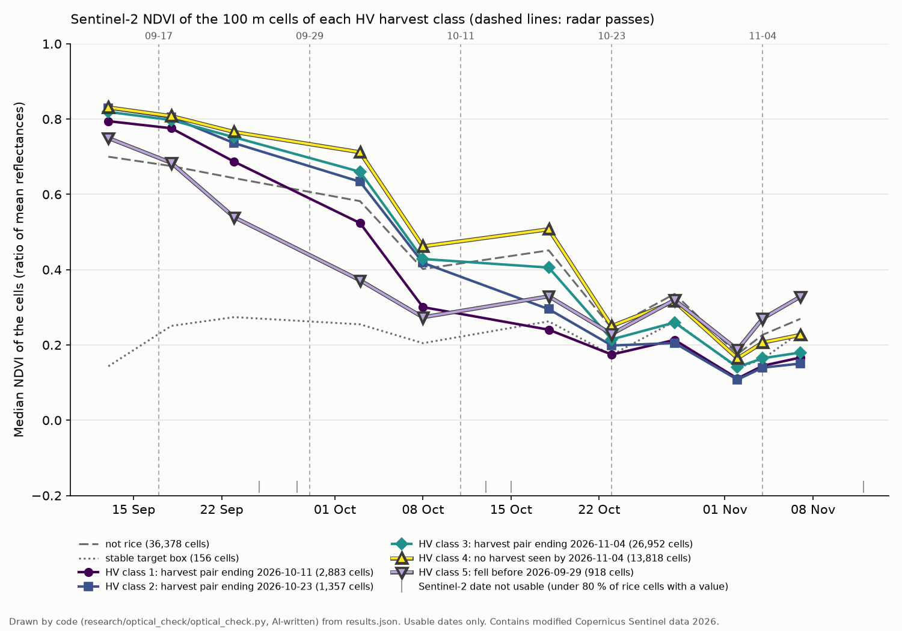

# Optical cross-check of the harvest map: results

**AI-written.** Made by `optical_check.py run` at 2026-11-15T05:03:13+00:00; the code is AI-written (Claude Opus 5.5, Anthropic). A comparison made after the fact; not for the public site. The method is in `README.md`, fixed before the run. Every number is in `results.json`.

Contains modified Copernicus Sentinel data 2026 (Sentinel-2 Level-2A, read from the Earth Search catalog by Element 84).

## Dates (step 5)

Scenes of tile 43RDQ from 2026-09-10 to 2026-11-14; a date is usable when at least 80 % of the test's 45,928 rice cells have a value.

| Date | Scene(s) | Rice cells with a value | Usable |
|---|---|---|---|
| 2026-09-13 | S2C_43RDQ_20260913_0_L2A | 90.6 % | yes |
| 2026-09-18 | S2B_43RDQ_20260918_0_L2A | 92.5 % | yes |
| 2026-09-23 | S2C_43RDQ_20260923_0_L2A | 98.2 % | yes |
| 2026-09-25 | S2A_43RDQ_20260925_1_L2A, S2A_43RDQ_20260925_0_L2A | 70.6 % | no |
| 2026-09-28 | S2B_43RDQ_20260928_0_L2A | 39.1 % | no |
| 2026-10-03 | S2C_43RDQ_20261003_0_L2A | 100.0 % | yes |
| 2026-10-08 | S2B_43RDQ_20261008_1_L2A | 84.1 % | yes |
| 2026-10-13 | S2C_43RDQ_20261013_0_L2A | 65.9 % | no |
| 2026-10-15 | S2A_43RDQ_20261015_1_L2A, S2A_43RDQ_20261015_0_L2A | 8.6 % | no |
| 2026-10-18 | S2B_43RDQ_20261018_0_L2A | 100.0 % | yes |
| 2026-10-23 | S2C_43RDQ_20261023_0_L2A | 98.1 % | yes |
| 2026-10-28 | S2B_43RDQ_20261028_1_L2A | 100.0 % | yes |
| 2026-11-02 | S2C_43RDQ_20261102_0_L2A | 99.9 % | yes |
| 2026-11-04 | S2A_43RDQ_20261104_1_L2A, S2A_43RDQ_20261104_0_L2A | 90.3 % | yes |
| 2026-11-07 | S2B_43RDQ_20261107_0_L2A | 100.0 % | yes |
| 2026-11-12 | S2C_43RDQ_20261112_0_L2A | 20.3 % | no |

Usable dates: 2026-09-13, 2026-09-18, 2026-09-23, 2026-10-03, 2026-10-08, 2026-10-18, 2026-10-23, 2026-10-28, 2026-11-02, 2026-11-04, 2026-11-07.

## NDVI by radar class and date (step 7)

Median [quartiles] (number of cells with a value) of the cell NDVI. Classes: 1, 2, 3 = harvest pair ending 2026-10-11, 2026-10-23, 2026-11-04; 4 = no harvest seen by 2026-11-04; 5 = fell before 2026-09-29. The stable target's box holds every cell whose centre lies in it.

### HV

| Date | 1 (2,883 cells) | 2 (1,357 cells) | 3 (26,952 cells) | 4 (13,818 cells) | 5 (918 cells) | not rice (36,378 cells) | stable target box (156 cells) |
|---|---|---|---|---|---|---|---|
| 2026-09-13 | 0.79 [0.76, 0.82] (2,582) | 0.83 [0.80, 0.86] (1,245) | 0.82 [0.79, 0.85] (24,695) | 0.83 [0.79, 0.87] (12,306) | 0.75 [0.70, 0.81] (789) | 0.70 [0.53, 0.78] (29,395) | 0.14 [0.09, 0.27] (60) |
| 2026-09-18 | 0.78 [0.73, 0.81] (2,705) | 0.80 [0.77, 0.83] (1,305) | 0.80 [0.76, 0.82] (24,559) | 0.81 [0.77, 0.83] (13,032) | 0.68 [0.53, 0.77] (880) | 0.68 [0.49, 0.76] (32,556) | 0.25 [0.14, 0.37] (101) |
| 2026-09-23 | 0.69 [0.63, 0.73] (2,811) | 0.74 [0.69, 0.77] (1,322) | 0.75 [0.71, 0.79] (26,523) | 0.77 [0.72, 0.80] (13,547) | 0.54 [0.40, 0.69] (882) | 0.64 [0.46, 0.73] (35,159) | 0.27 [0.17, 0.39] (156) |
| 2026-10-03 | 0.52 [0.43, 0.60] (2,883) | 0.63 [0.57, 0.70] (1,357) | 0.66 [0.59, 0.73] (26,952) | 0.71 [0.63, 0.78] (13,818) | 0.37 [0.25, 0.55] (918) | 0.58 [0.39, 0.69] (36,377) | 0.25 [0.15, 0.35] (156) |
| 2026-10-08 | 0.30 [0.25, 0.36] (2,705) | 0.42 [0.37, 0.47] (1,311) | 0.43 [0.38, 0.47] (21,779) | 0.46 [0.41, 0.51] (11,997) | 0.27 [0.22, 0.36] (842) | 0.40 [0.31, 0.47] (30,892) | 0.20 [0.14, 0.27] (156) |
| 2026-10-18 | 0.24 [0.19, 0.31] (2,883) | 0.30 [0.23, 0.39] (1,357) | 0.41 [0.31, 0.51] (26,952) | 0.51 [0.38, 0.62] (13,818) | 0.33 [0.24, 0.45] (918) | 0.45 [0.31, 0.60] (36,378) | 0.26 [0.16, 0.39] (156) |
| 2026-10-23 | 0.17 [0.14, 0.21] (2,793) | 0.20 [0.18, 0.22] (1,347) | 0.21 [0.19, 0.25] (26,445) | 0.25 [0.21, 0.30] (13,589) | 0.23 [0.19, 0.28] (898) | 0.24 [0.19, 0.31] (35,883) | 0.17 [0.12, 0.23] (156) |
| 2026-10-28 | 0.21 [0.18, 0.27] (2,883) | 0.20 [0.18, 0.23] (1,357) | 0.26 [0.22, 0.30] (26,952) | 0.32 [0.26, 0.39] (13,818) | 0.32 [0.24, 0.44] (918) | 0.34 [0.25, 0.45] (36,378) | 0.26 [0.16, 0.39] (156) |
| 2026-11-02 | 0.11 [0.08, 0.15] (2,882) | 0.11 [0.07, 0.14] (1,357) | 0.14 [0.10, 0.17] (26,952) | 0.16 [0.13, 0.19] (13,811) | 0.19 [0.14, 0.26] (893) | 0.18 [0.13, 0.22] (36,199) | 0.14 [0.09, 0.21] (156) |
| 2026-11-04 | 0.14 [0.11, 0.19] (2,797) | 0.14 [0.10, 0.18] (1,328) | 0.16 [0.12, 0.20] (24,197) | 0.21 [0.17, 0.24] (12,300) | 0.27 [0.18, 0.39] (868) | 0.23 [0.17, 0.31] (33,261) | 0.16 [0.10, 0.23] (156) |
| 2026-11-07 | 0.17 [0.13, 0.24] (2,883) | 0.15 [0.12, 0.19] (1,357) | 0.18 [0.14, 0.22] (26,952) | 0.23 [0.18, 0.27] (13,818) | 0.33 [0.19, 0.49] (918) | 0.27 [0.20, 0.37] (36,378) | 0.23 [0.15, 0.36] (156) |

### HH

| Date | 1 (4,566 cells) | 2 (5,856 cells) | 3 (10,081 cells) | 4 (25,136 cells) | 5 (289 cells) | not rice (36,378 cells) | stable target box (156 cells) |
|---|---|---|---|---|---|---|---|
| 2026-09-13 | 0.80 [0.77, 0.82] (4,148) | 0.83 [0.80, 0.86] (5,408) | 0.83 [0.80, 0.87] (9,192) | 0.82 [0.78, 0.85] (22,639) | 0.73 [0.68, 0.77] (230) | 0.70 [0.53, 0.78] (29,395) | 0.14 [0.09, 0.27] (60) |
| 2026-09-18 | 0.78 [0.74, 0.81] (4,261) | 0.81 [0.77, 0.83] (5,439) | 0.80 [0.77, 0.83] (9,256) | 0.80 [0.76, 0.83] (23,246) | 0.65 [0.47, 0.72] (279) | 0.68 [0.49, 0.76] (32,556) | 0.25 [0.14, 0.37] (101) |
| 2026-09-23 | 0.70 [0.65, 0.74] (4,479) | 0.76 [0.72, 0.79] (5,774) | 0.77 [0.72, 0.80] (9,869) | 0.75 [0.70, 0.79] (24,682) | 0.48 [0.34, 0.58] (281) | 0.64 [0.46, 0.73] (35,159) | 0.27 [0.17, 0.39] (156) |
| 2026-10-03 | 0.55 [0.48, 0.60] (4,566) | 0.66 [0.61, 0.72] (5,856) | 0.70 [0.62, 0.77] (10,081) | 0.68 [0.60, 0.75] (25,136) | 0.23 [0.17, 0.32] (289) | 0.58 [0.39, 0.69] (36,377) | 0.25 [0.15, 0.35] (156) |
| 2026-10-08 | 0.32 [0.27, 0.37] (4,298) | 0.44 [0.40, 0.48] (5,153) | 0.45 [0.40, 0.49] (7,907) | 0.44 [0.39, 0.49] (21,002) | 0.21 [0.17, 0.25] (274) | 0.40 [0.31, 0.47] (30,892) | 0.20 [0.14, 0.27] (156) |
| 2026-10-18 | 0.23 [0.19, 0.28] (4,566) | 0.36 [0.28, 0.46] (5,856) | 0.47 [0.36, 0.57] (10,081) | 0.45 [0.34, 0.57] (25,136) | 0.23 [0.15, 0.29] (289) | 0.45 [0.31, 0.60] (36,378) | 0.26 [0.16, 0.39] (156) |
| 2026-10-23 | 0.17 [0.14, 0.19] (4,444) | 0.20 [0.18, 0.22] (5,777) | 0.23 [0.20, 0.27] (9,967) | 0.23 [0.20, 0.28] (24,603) | 0.20 [0.15, 0.26] (281) | 0.24 [0.19, 0.31] (35,883) | 0.17 [0.12, 0.23] (156) |
| 2026-10-28 | 0.21 [0.18, 0.24] (4,566) | 0.22 [0.20, 0.24] (5,856) | 0.27 [0.24, 0.32] (10,081) | 0.29 [0.25, 0.36] (25,136) | 0.30 [0.18, 0.45] (289) | 0.34 [0.25, 0.45] (36,378) | 0.26 [0.16, 0.39] (156) |
| 2026-11-02 | 0.10 [0.07, 0.14] (4,565) | 0.12 [0.08, 0.15] (5,856) | 0.15 [0.10, 0.17] (10,081) | 0.16 [0.13, 0.18] (25,124) | 0.19 [0.11, 0.28] (269) | 0.18 [0.13, 0.22] (36,199) | 0.14 [0.09, 0.21] (156) |
| 2026-11-04 | 0.13 [0.10, 0.17] (4,448) | 0.14 [0.11, 0.18] (5,456) | 0.17 [0.12, 0.20] (8,957) | 0.19 [0.16, 0.23] (22,347) | 0.30 [0.15, 0.42] (282) | 0.23 [0.17, 0.31] (33,261) | 0.16 [0.10, 0.23] (156) |
| 2026-11-07 | 0.15 [0.12, 0.20] (4,566) | 0.16 [0.13, 0.20] (5,856) | 0.17 [0.13, 0.21] (10,081) | 0.22 [0.17, 0.26] (25,136) | 0.38 [0.15, 0.56] (289) | 0.27 [0.20, 0.37] (36,378) | 0.23 [0.15, 0.36] (156) |

_Figure drawn by code (`optical_check.py`) from the numbers in `results.json`._

## Thresholds and the days around each pass (step 8)

- **T_pooled** = 0.4650, from 442,369 cell values on 10 usable dates (2026-09-18, 2026-09-23, 2026-10-03, 2026-10-08, 2026-10-18, 2026-10-23, 2026-10-28, 2026-11-02, 2026-11-04, 2026-11-07).
- **T_strict** = 0.1945, from 9,505 cell values on 3 usable dates (2026-10-28, 2026-11-02, 2026-11-04).
- Caveat: ripening rice loses green before it is cut, so T_pooled calls some standing, ripe rice "cut".

| Radar pass | Last usable date on or before | First usable date on or after |
|---|---|---|
| 2026-10-11 | 2026-10-08 | 2026-10-18 |
| 2026-10-23 | 2026-10-23 | 2026-10-23 |
| 2026-11-04 | 2026-11-04 | 2026-11-04 |

Last usable date of the series: 2026-11-07.

## Tables (step 9)

### T_pooled

**Cells each polarization calls "no harvest seen by 4 November" (class 4): share cut.**

| Polarization | Day | Date | Cells | Cut | Not cut | Never green |
|---|---|---|---|---|---|---|
| HH | on or before 2026-11-04 | 2026-11-04 | 25,136 | 99.4 % | 0.1 % | 0.4 % |
| HH | on or after 2026-11-04 | 2026-11-04 | 25,136 | 99.4 % | 0.1 % | 0.4 % |
| HH | last usable date | 2026-11-07 | 25,136 | 99.4 % | 0.1 % | 0.4 % |
| HV | on or before 2026-11-04 | 2026-11-04 | 13,818 | 99.4 % | 0.2 % | 0.4 % |
| HV | on or after 2026-11-04 | 2026-11-04 | 13,818 | 99.4 % | 0.2 % | 0.4 % |
| HV | last usable date | 2026-11-07 | 13,818 | 99.4 % | 0.2 % | 0.4 % |

**Share of the test's rice cells cut by each day, beside the radar and the official figures.**

| Pass | Day | Date | Optical: cut | Never green | Radar HH: pair by pass | Radar HV: pair by pass | Official figures |
|---|---|---|---|---|---|---|---|
| 2026-10-11 | on or before | 2026-10-08 | 56.2 % | 0.5 % | 9.9 % | 6.3 % | no figure found |
| 2026-10-11 | on or after | 2026-10-18 | 70.5 % | 0.4 % | 9.9 % | 6.3 % | no figure found |
| 2026-10-23 | on or before | 2026-10-23 | 98.8 % | 0.4 % | 22.7 % | 9.2 % | Punjab 34.82 % harvested till 23 October; Tarn Taran district 73 %, Amritsar 83 %, in the same report without a date of their own (PTI, 24 October) |
| 2026-10-23 | on or after | 2026-10-23 | 98.8 % | 0.4 % | 22.7 % | 9.2 % | Punjab 34.82 % harvested till 23 October; Tarn Taran district 73 %, Amritsar 83 %, in the same report without a date of their own (PTI, 24 October) |
| 2026-11-04 | on or before | 2026-11-04 | 99.6 % | 0.3 % | 44.6 % | 67.9 % | Punjab 85.10 % as of 4 November (Punjab Pollution Control Board, ANI, 5 November); more than 90 % of Tarn Taran and Amritsar together (PTI, 2 November, without a date of its own) |
| 2026-11-04 | on or after | 2026-11-04 | 99.6 % | 0.3 % | 44.6 % | 67.9 % | Punjab 85.10 % as of 4 November (Punjab Pollution Control Board, ANI, 5 November); more than 90 % of Tarn Taran and Amritsar together (PTI, 2 November, without a date of its own) |

**Cells given a harvest pair ending on the pass: share cut by the first usable date on or after it.**

| Pass | Date | Polarization | Cells | Cut | Still not cut | Never green |
|---|---|---|---|---|---|---|
| 2026-10-11 | 2026-10-18 | HH | 4,566 | 99.5 % | 0.4 % | 0.2 % |
| 2026-10-11 | 2026-10-18 | HV | 2,883 | 95.7 % | 4.1 % | 0.2 % |
| 2026-10-23 | 2026-10-23 | HH | 5,856 | 99.6 % | 0.4 % | 0.0 % |
| 2026-10-23 | 2026-10-23 | HV | 1,357 | 99.9 % | 0.1 % | 0.1 % |
| 2026-11-04 | 2026-11-04 | HH | 10,081 | 99.9 % | 0.0 % | 0.1 % |
| 2026-11-04 | 2026-11-04 | HV | 26,952 | 99.8 % | 0.0 % | 0.2 % |

**Agreement with the optical state** (cells where both say harvested or both say not; 95 % interval from a block bootstrap, blocks of 10 x 10 cells, 2000 replicates, seed 20261115). Left out: cells that fell before 29 September (no harvest pair) and never-green cells.

| Pass | Day | Date | Polarization | Agreement | 95 % interval | Cells used |
|---|---|---|---|---|---|---|
| 2026-10-11 | on or before | 2026-10-08 | HH | 52.5 % | 50.5 % to 54.5 % | 45,442 |
| 2026-10-11 | on or before | 2026-10-08 | HV | 49.3 % | 47.1 % to 51.5 % | 44,848 |
| 2026-10-11 | on or after | 2026-10-18 | HH | 39.3 % | 37.8 % to 40.8 % | 45,482 |
| 2026-10-11 | on or after | 2026-10-18 | HV | 35.4 % | 33.9 % to 37.0 % | 44,877 |
| 2026-10-23 | on or before | 2026-10-23 | HH | 23.6 % | 22.4 % to 24.7 % | 45,482 |
| 2026-10-23 | on or before | 2026-10-23 | HV | 10.2 % | 9.4 % to 11.0 % | 44,877 |
| 2026-10-23 | on or after | 2026-10-23 | HH | 23.6 % | 22.4 % to 24.7 % | 45,482 |
| 2026-10-23 | on or after | 2026-10-23 | HV | 10.2 % | 9.4 % to 11.0 % | 44,877 |
| 2026-11-04 | on or before | 2026-11-04 | HH | 45.1 % | 43.8 % to 46.2 % | 45,508 |
| 2026-11-04 | on or before | 2026-11-04 | HV | 69.4 % | 68.1 % to 70.7 % | 44,898 |
| 2026-11-04 | on or after | 2026-11-04 | HH | 45.1 % | 43.8 % to 46.2 % | 45,508 |
| 2026-11-04 | on or after | 2026-11-04 | HV | 69.4 % | 68.1 % to 70.7 % | 44,898 |

**Cut cells at or above the threshold again on the next usable date.**

| Pass | Day | Date | Cut cells | Measured | Back to green | Share |
|---|---|---|---|---|---|---|
| 2026-10-11 | on or before | 2026-10-08 | 25,805 | 25,567 | 4,751 | 18.6 % |
| 2026-10-11 | on or after | 2026-10-18 | 32,385 | 32,122 | 4,751 | 14.8 % |
| 2026-10-23 | on or before | 2026-10-23 | 45,378 | 45,115 | 6,353 | 14.1 % |
| 2026-10-23 | on or after | 2026-10-23 | 45,378 | 45,115 | 6,353 | 14.1 % |
| 2026-11-04 | on or before | 2026-11-04 | 45,742 | 45,478 | 6,471 | 14.2 % |
| 2026-11-04 | on or after | 2026-11-04 | 45,742 | 45,478 | 6,471 | 14.2 % |

### T_strict

**Cells each polarization calls "no harvest seen by 4 November" (class 4): share cut.**

| Polarization | Day | Date | Cells | Cut | Not cut | Never green |
|---|---|---|---|---|---|---|
| HH | on or before 2026-11-04 | 2026-11-04 | 25,136 | 83.7 % | 16.2 % | 0.1 % |
| HH | on or after 2026-11-04 | 2026-11-04 | 25,136 | 83.7 % | 16.2 % | 0.1 % |
| HH | last usable date | 2026-11-07 | 25,136 | 84.1 % | 15.9 % | 0.1 % |
| HV | on or before 2026-11-04 | 2026-11-04 | 13,818 | 78.9 % | 21.0 % | 0.1 % |
| HV | on or after 2026-11-04 | 2026-11-04 | 13,818 | 78.9 % | 21.0 % | 0.1 % |
| HV | last usable date | 2026-11-07 | 13,818 | 79.3 % | 20.6 % | 0.1 % |

**Share of the test's rice cells cut by each day, beside the radar and the official figures.**

| Pass | Day | Date | Optical: cut | Never green | Radar HH: pair by pass | Radar HV: pair by pass | Official figures |
|---|---|---|---|---|---|---|---|
| 2026-10-11 | on or before | 2026-10-08 | 0.7 % | 0.1 % | 9.9 % | 6.3 % | no figure found |
| 2026-10-11 | on or after | 2026-10-18 | 4.5 % | 0.1 % | 9.9 % | 6.3 % | no figure found |
| 2026-10-23 | on or before | 2026-10-23 | 28.3 % | 0.1 % | 22.7 % | 9.2 % | Punjab 34.82 % harvested till 23 October; Tarn Taran district 73 %, Amritsar 83 %, in the same report without a date of their own (PTI, 24 October) |
| 2026-10-23 | on or after | 2026-10-23 | 28.3 % | 0.1 % | 22.7 % | 9.2 % | Punjab 34.82 % harvested till 23 October; Tarn Taran district 73 %, Amritsar 83 %, in the same report without a date of their own (PTI, 24 October) |
| 2026-11-04 | on or before | 2026-11-04 | 88.9 % | 0.0 % | 44.6 % | 67.9 % | Punjab 85.10 % as of 4 November (Punjab Pollution Control Board, ANI, 5 November); more than 90 % of Tarn Taran and Amritsar together (PTI, 2 November, without a date of its own) |
| 2026-11-04 | on or after | 2026-11-04 | 88.9 % | 0.0 % | 44.6 % | 67.9 % | Punjab 85.10 % as of 4 November (Punjab Pollution Control Board, ANI, 5 November); more than 90 % of Tarn Taran and Amritsar together (PTI, 2 November, without a date of its own) |

**Cells given a harvest pair ending on the pass: share cut by the first usable date on or after it.**

| Pass | Date | Polarization | Cells | Cut | Still not cut | Never green |
|---|---|---|---|---|---|---|
| 2026-10-11 | 2026-10-18 | HH | 4,566 | 26.1 % | 73.9 % | 0.0 % |
| 2026-10-11 | 2026-10-18 | HV | 2,883 | 29.0 % | 71.0 % | 0.0 % |
| 2026-10-23 | 2026-10-23 | HH | 5,856 | 39.8 % | 60.2 % | 0.0 % |
| 2026-10-23 | 2026-10-23 | HV | 1,357 | 44.7 % | 55.3 % | 0.0 % |
| 2026-11-04 | 2026-11-04 | HH | 10,081 | 93.3 % | 6.7 % | 0.0 % |
| 2026-11-04 | 2026-11-04 | HV | 26,952 | 93.8 % | 6.1 % | 0.0 % |

**Agreement with the optical state** (cells where both say harvested or both say not; 95 % interval from a block bootstrap, blocks of 10 x 10 cells, 2000 replicates, seed 20261115). Left out: cells that fell before 29 September (no harvest pair) and never-green cells.

| Pass | Day | Date | Polarization | Agreement | 95 % interval | Cells used |
|---|---|---|---|---|---|---|
| 2026-10-11 | on or before | 2026-10-08 | HH | 89.9 % | 89.1 % to 90.8 % | 45,613 |
| 2026-10-11 | on or before | 2026-10-08 | HV | 93.7 % | 93.0 % to 94.3 % | 44,985 |
| 2026-10-11 | on or after | 2026-10-18 | HH | 91.1 % | 90.3 % to 91.8 % | 45,623 |
| 2026-10-11 | on or after | 2026-10-18 | HV | 93.2 % | 92.6 % to 93.7 % | 44,994 |
| 2026-10-23 | on or before | 2026-10-23 | HH | 74.2 % | 73.2 % to 75.2 % | 45,623 |
| 2026-10-23 | on or before | 2026-10-23 | HV | 73.8 % | 72.4 % to 75.2 % | 44,994 |
| 2026-10-23 | on or after | 2026-10-23 | HH | 74.2 % | 73.2 % to 75.2 % | 45,623 |
| 2026-10-23 | on or after | 2026-10-23 | HV | 73.8 % | 72.4 % to 75.2 % | 44,994 |
| 2026-11-04 | on or before | 2026-11-04 | HH | 51.8 % | 50.7 % to 52.9 % | 45,625 |
| 2026-11-04 | on or before | 2026-11-04 | HV | 71.6 % | 70.5 % to 72.6 % | 44,996 |
| 2026-11-04 | on or after | 2026-11-04 | HH | 51.8 % | 50.7 % to 52.9 % | 45,625 |
| 2026-11-04 | on or after | 2026-11-04 | HV | 71.6 % | 70.5 % to 72.6 % | 44,996 |

**Cut cells at or above the threshold again on the next usable date.**

| Pass | Day | Date | Cut cells | Measured | Back to green | Share |
|---|---|---|---|---|---|---|
| 2026-10-11 | on or before | 2026-10-08 | 342 | 338 | 113 | 33.4 % |
| 2026-10-11 | on or after | 2026-10-18 | 2,051 | 2,012 | 160 | 8.0 % |
| 2026-10-23 | on or before | 2026-10-23 | 13,013 | 12,974 | 8,425 | 64.9 % |
| 2026-10-23 | on or after | 2026-10-23 | 13,013 | 12,974 | 8,425 | 64.9 % |
| 2026-11-04 | on or before | 2026-11-04 | 40,810 | 38,404 | 17,753 | 46.2 % |
| 2026-11-04 | on or after | 2026-11-04 | 40,810 | 38,404 | 17,753 | 46.2 % |

## Reading (AI-written, hypotheses only)

<!-- reading:start -->
_AI-written (Claude Opus 5.5, Anthropic). Each line is a hypothesis, not a finding._

1. Before any harvest pass the HV classes already lie in the order the radar called them: median NDVI on 3 October 0.52, 0.63, 0.66, 0.71 for classes 1 to 4, and on the clear 18 October 0.24, 0.30, 0.41, 0.51. So HV's "no harvest seen" may be mostly rice that ripened or was cut later, not rice the radar cannot see. In HH classes 3 and 4 are not apart (0.70 and 0.68 on 3 October).
2. On the clear 7 November the class 4 median (HV 0.23, HH 0.22) equals that of the Patti town box (0.23) and lies below the cells that are not rice (0.27): little of class 4 looks like a green crop then. Ripe standing rice is not green either, so this alone does not show that it was cut.
3. Three usable dates look hazy (8 October, 23 October, 2 November): no pixel of the window is classed vegetation, ESA's own tile figures agree, and the darkest pixels are 600 to 1,200 values brighter than on the clear dates around them. The not-rice cells, class 5 and the town box dip on each of them and recover on the next clear date. The method keeps them (they pass the 80 % rule), and many cut days fall on them: 22,563 of 45,744 under T_pooled on 8 October, 26,811 of 40,958 under T_strict on 2 November.
4. T_pooled (0.465) calls 56 % of the rice cells cut by 8 October and 99 % by 23 October, far ahead of the official figures. It measures the loss of green with ripening (the brief's caveat), plus the haze: an upper bound, if anything.
5. T_strict (0.195) gives 28 % of the rice cells cut by 23 October and 89 % by 4 November (official, Punjab: 34.82 % and 85.10 %), and 84 % (HH) and 79 % (HV) of class 4 cut by 4 November. The threshold itself pools 28 October (clear), 2 November (hazy) and 4 November.
6. Exploratory, added after seeing the data (`exploratory_unit_check.py`, `exploratory_results.json`): without the three dates the offset guard could not check, the same steps give T_strict 0.211 and 57 % (HH) and 48 % (HV) of class 4 cut by 4 November. The share of "no harvest seen" cells the index calls cut may lie anywhere from about one half to four fifths, and one hazy date moves it most.
7. In either reading, a large part of the radar's "no harvest seen by 4 November" lost its green by then without a harvest pair: a hypothesis to test against field reports or a denser optical series (HLS adds Landsat dates).
8. A cut resting on one date is weak here: 14 to 19 % of T_pooled's cut cells and 8 to 65 % of T_strict's are at or above the threshold again on the next usable date, most after the hazy 23 October.
9. Agreement at 4 November is 71.6 % (HV) and 51.8 % (HH) under T_strict, 69.4 % and 45.1 % under T_pooled. With the index calling nearly every cell cut, agreement mostly follows the share each map calls harvested (HV 67.9 %, HH 44.6 %). The marker decision is not reopened.
<!-- reading:end -->

## What this cannot do (step 10)

- An optical index sees green, not stems: ripening, weeds, a second crop and smoke haze all move it.
- A 100 m cell holds several fields.
- Cloud and smoke leave gaps, so "cut by day D" depends on which dates are usable.
- Sentinel-2 passes at about 11:00 local time and NISAR at 05:43, days apart.
- The comparison is made afterwards, like the fire check.
- The marker decision (HV) is not reopened by this: it was made by a rule fixed beforehand. The numbers are reported for HH and HV without recommending a change.
- T_pooled separates green from not green; ripening rice loses green before it is cut, so this threshold calls some standing, ripe rice "cut".
